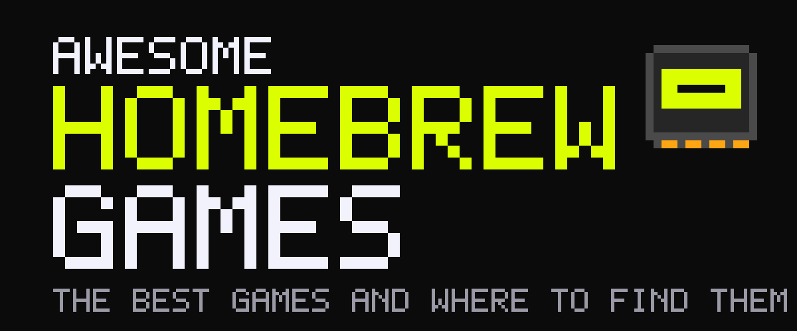

<a href="https://enzovezzaro.github.io/awesome-homebrew-games/">
     
</a>


<br/>
<br/>

<div align="center">
    <strong>A directory of homebrew games and the hubs, scenes and tools where you find them.</strong>
    <br />
    <br />

</div>

<div align="center">

[](https://awesome.re)
<!-- BEGIN:count -->

<!-- END:count -->
[](https://github.com/EnzoVezzaro/awesome-homebrew-games)
[](LICENSE)
[](https://enzovezzaro.github.io/awesome-homebrew-games/)

</div>

# Awesome Homebrew Games

Pick your hardware, find the places that release games for it, and start playing. Every entry is a place you can open today: a marketplace, a community database, a cartridge maker, a jam or a toolchain.

The [landing page](https://enzovezzaro.github.io/awesome-homebrew-games/) turns this list into a console. Insert the cartridge, filter by platform and open anything in one click. The same data ships as `llms.txt`, so your AI assistant can answer "where do I find new Game Boy games?" from this list instead of guessing.

<div align="center">
  <a href="https://enzovezzaro.github.io/awesome-homebrew-games/">
    
  </a>
</div>


## What is homebrew?

Homebrew is software that hobbyists and indie teams write for a machine without the manufacturer's blessing, or for a fantasy console built to be programmed. People still release new games for the NES, the Game Boy, the Genesis and the Dreamcast, and some of them ship on real cartridges.

| Kind | Where it runs | Start with |
|------|---------------|------------|
| New games for old hardware | Real consoles, flash carts and emulators | Micro Mages on the NES |
| Fantasy console carts | A virtual console in a browser tab | Celeste Classic on PICO-8 |
| Open handhelds | Small devices designed to be programmed | Arduboy |
| Apps and games for modded consoles | Wii, DS, 3DS, Vita and Switch | The Open Shop Channel on Wii |

## Suggest an entry

Know a place that belongs here? [Open an issue](https://github.com/EnzoVezzaro/awesome-homebrew-games/issues/new?template=suggest-an-entry.yml) with the link and one sentence on what a visitor finds there.

This list does not link to ROM piracy. Entries must be about original homebrew, fan-made games and tools their authors made public, or places that host them.

<div align="center">
  
</div>


## Collection

<!-- BEGIN:collection -->
### Hubs and marketplaces

Cross-platform places to browse and download. Start here if you do not know what you want yet.

- [**itch.io**](https://itch.io) - Indie marketplace with tag pages for Game Boy, NES, PICO-8 and most other retro targets. Many games are free or pay what you want.
- [**itch.io Game Boy tag**](https://itch.io/games/tag-gameboy) - Every itch.io game tagged Game Boy, from ROMs for real cartridges to GB Studio projects.
- [**itch.io NES tag**](https://itch.io/games/tag-nes) - NES games on itch.io. Some are 8-bit styled PC games, so read the platform line before downloading.
- [**itch.io PICO-8 tag**](https://itch.io/games/tag-pico-8) - PICO-8 games that run in the browser tab and export from the console as a single cart.
- [**itch.io homebrew tag**](https://itch.io/games/tag-homebrew) - Games that authors themselves labeled homebrew, across every platform on the site.
- [**Game Jolt**](https://gamejolt.com) - Free indie and fan game platform that also hosts jams.
- [**GBAtemp**](https://gbatemp.net) - Console hacking forum with release threads for GBA, DS, 3DS, Wii and Switch homebrew.
- [**ROMhacking.net**](https://www.romhacking.net) - Archive of ROM hacks, translations and utilities, with a separate section for original homebrew.

### Platform scenes

One console or computer per community. These are the databases, wikis and forums where each scene keeps its releases.

- [**Homebrew Hub**](https://hh.gbdev.io) - Game Boy and Game Boy Color homebrew database from the gbdev community. Entries link a ROM download.
- [**gbdev.io**](https://gbdev.io) - Front door to the Game Boy development community, with Pan Docs, tool lists and community links.
- [**NESdev**](https://www.nesdev.org) - Wiki and forum for NES and Famicom programmers. Most documented NES homebrew technique starts here.
- [**SMS Power!**](https://www.smspower.org) - Master System, Game Gear and SG-1000 site with a homebrew section and the SMS Power Coding Competition.
- [**N64brew**](https://n64brew.dev) - Wiki and community for Nintendo 64 homebrew, and the host of the N64brew Game Jam.
- [**AtariAge**](https://atariage.com) - Forums, a software database and a store for Atari homebrew, including new 2600, 5200 and 7800 cartridges.
- [**CSDb**](https://csdb.dk) - The Commodore 64 Scene Database. It catalogs games, demos and music releases by group.
- [**Spectrum Computing**](https://spectrumcomputing.co.uk) - ZX Spectrum database and forum that includes new releases next to the classics.
- [**MSX Resource Center**](https://www.msx.org) - News, forums and a software database for MSX, where new homebrew still appears.
- [**Neo Geo Dev Wiki**](https://wiki.neogeodev.org) - Technical wiki for programming the Neo Geo, from memory maps to the sprite system.
- [**Universal-DB**](https://db.universal-team.net) - Database of Nintendo DS and 3DS homebrew apps and games, maintained by Universal-Team.
- [**Open Shop Channel**](https://oscwii.org) - Homebrew app store for the Wii, with a web catalog you can browse before touching the console.
- [**Homebrew App Store**](https://github.com/fortheusers/hb-appstore) - Package repository for Switch and Wii U homebrew. It installs from the console and keeps its source and releases on GitHub.
- [**VitaDB**](https://www.rinnegatamante.eu/vitadb/#/) - Catalog of PlayStation Vita homebrew games, ports and tools, maintained by Rinnegatamante.

### Fantasy consoles and open handhelds

Machines that exist to be programmed. Carts are tiny, shareable and playable in a browser tab.

- [**PICO-8**](https://www.lexaloffle.com/pico-8.php) - Fantasy console with a 128x128 screen and 16 colors. A finished game is one PNG image you can pass around.
- [**Lexaloffle BBS**](https://www.lexaloffle.com/bbs/?cat=7) - The forum where PICO-8 carts are posted. Every cart plays in the browser.
- [**TIC-80**](https://tic80.com) - Free and open source fantasy computer with a built-in code, sprite and music editor and a public cart library.
- [**WASM-4**](https://wasm4.org) - Fantasy console where games are WebAssembly modules, so you can write them in Rust, Zig, C or AssemblyScript.
- [**Pyxel**](https://github.com/kitao/pyxel) - Retro game engine for Python with 16 colors and four sound channels.
- [**Uxn**](https://100r.co/site/uxn.html) - A tiny virtual machine from Hundred Rabbits. Programs are a few kilobytes and run on anything from a Game Boy to a laptop.
- [**Arduboy**](https://arduboy.com) - Credit card sized open source handheld with a monochrome OLED. Games are Arduino sketches.
- [**Gamebuino META**](https://gamebuino.com) - Open source handheld for learning to program games, with an online library of community titles.
- [**Thumby**](https://thumby.us) - Keychain sized console from TinyCircuits with a 72x40 screen, programmed in MicroPython.

### Hall of fame

Homebrew games worth starting with, each made for real or fantasy hardware.

- [**Celeste Classic**](https://www.lexaloffle.com/bbs/?tid=2145) - Maddy Thorson and Noel Berry built this PICO-8 platformer in four days. It became Celeste.
- [**Micro Mages**](https://morphcat.de/micromages/) - Four-player co-op platformer by Morphcat Games, released on a real NES cartridge in 2019.
- [**POOM**](https://freds72.itch.io/poom) - A Doom-style first person shooter running inside PICO-8's memory and CPU limits.
- [**Super Tilt Bro.**](https://sgadrat.itch.io/super-tilt-bro) - Platform fighter for the NES in the style of Smash Bros., by sgadrat.
- [**Tobu Tobu Girl**](https://tangramgames.dk/tobutobugirl/) - Vertical-scrolling arcade game for the Game Boy by Tangram Games.
- [**Xeno Crisis**](https://www.bitmapbureau.com/games/xeno-crisis) - Twin-stick shooter by Bitmap Bureau, released on a Sega Genesis cartridge in 2019.
- [**Gunlord**](https://en.wikipedia.org/wiki/Gunlord) - Side-scrolling shooter by NG:DEV.TEAM, released for Neo Geo and Dreamcast in 2012.

### Studios and cartridge makers

Teams that release new games on physical cartridges for old consoles.

- [**Bitmap Bureau**](https://www.bitmapbureau.com) - UK studio behind Xeno Crisis and Final Vendetta.
- [**NG:DEV.TEAM**](https://www.ngdevteam.com) - German team that has released Last Hope, Fast Striker and Gunlord on Neo Geo and Dreamcast.
- [**Mega Cat Studios**](https://www.megacatstudios.com) - Pittsburgh studio and publisher of new games for classic consoles.
- [**Piko Interactive**](https://pikointeractive.com) - Publisher of new and re-released games for older systems.
- [**CollectorVision**](https://collectorvision.com) - New ColecoVision games and hardware, sold as cartridges.
- [**Super Fighter Team**](https://www.superfighterteam.com) - Publisher of Beggar Prince and other new Genesis cartridges.
- [**Mojon Twins**](https://www.mojontwins.com) - Spanish developers who release games for 8-bit machines and publish the engines they use.

### Jams and competitions

Deadlines produce games. These events produce a lot of them.

- [**Ludum Dare**](https://ldjam.com) - Long-running game jam with a 48 hour solo compo and a 72 hour team jam.
- [**itch.io Jams**](https://itch.io/jams) - Calendar of every jam on itch.io. Filter for console-specific ones such as Game Boy and PICO-8 jams.
- [**Mini Jam**](https://minijamofficial.com) - Weekend jams on itch.io, each with a one-word theme and a rule that limits what you can use.

### Build your own

Toolchains, engines and references for writing a game for hardware that shipped decades ago.

- [**GB Studio**](https://www.gbstudio.dev) - Visual editor that exports a real Game Boy ROM. You can make a game without writing code.
- [**GBDK-2020**](https://github.com/gbdk-2020/gbdk-2020) - C compiler and libraries for the Game Boy, Master System and Game Gear.
- [**Pan Docs**](https://gbdev.io/pandocs/) - The Game Boy technical reference. Registers, timing, memory map and cartridge formats.
- [**SGDK**](https://github.com/Stephane-D/SGDK) - Sega Mega Drive and Genesis development kit in C, with sprite, sound and tile libraries.
- [**cc65**](https://cc65.github.io) - C compiler and assembler for 6502 machines, including the NES, Commodore 64 and Atari 8-bit.
- [**devkitPro**](https://devkitpro.org) - Toolchains and libraries for Game Boy Advance, DS, 3DS, Wii, Wii U and Switch homebrew.
- [**libdragon**](https://libdragon.dev) - Open source SDK for writing Nintendo 64 games.
- [**Wonderful Toolchain**](https://wonderful.asie.pl) - Toolchain for the WonderSwan and other unusual targets.
- [**LÖVE**](https://love2d.org) - 2D game framework for Lua. A common first step before targeting real hardware.

### Run it anywhere

Emulators, FPGA, flash carts and handheld firmware for playing homebrew on a screen you like.

- [**RetroArch**](https://www.retroarch.com) - Front end that runs emulator cores for most systems in this list, on PC, phones and handhelds.
- [**Batocera**](https://batocera.org) - Linux distribution that boots straight into a retro game library from a USB stick.
- [**Recalbox**](https://www.recalbox.com) - Retro gaming OS for Raspberry Pi and PC with a controller-first menu.
- [**MiSTer FPGA**](https://misterfpga.org) - Open source FPGA project that recreates old consoles and computers in hardware, with cores for new homebrew.
- [**Krikzz**](https://krikzz.com) - Maker of the EverDrive flash carts, which run homebrew ROMs on real hardware from an SD card.
- [**muOS**](https://muos.dev) - Custom operating system for Anbernic handhelds.
- [**ROCKNIX**](https://rocknix.org) - Linux distribution for retro handhelds based on Rockchip and other chips.
- [**Knulli**](https://knulli.org) - Batocera-based firmware for handheld consoles.
<!-- END:collection -->


## What's inside each entry

The data lives in [`data/collection.json`](data/collection.json). The list above, `llms.txt` and the landing page are all generated from it by `npm run build`.

| Field | What it holds |
|-------|---------------|
| `name` | What the place or game is called |
| `url` | An https link that was checked when the entry was added |
| `category` | One of the eight sections above |
| `platforms` | The hardware it serves, used for the landing page filter |
| `blurb` | One or two plain sentences on what you find there |

### Use it with an AI agent

1. Give your assistant [`llms.txt`](llms.txt), or the raw [`data/collection.json`](data/collection.json) if it prefers structured data.
2. Say what hardware you own and what you want to do.

```text
Read llms.txt from this repo. I own a Game Boy Color and an EverDrive-style flash cart.
Where do I find new games, and which entries should I open first?
```

```text
I want to write my first NES game. Using the entries in llms.txt, give me a reading
order and say what each one is for.
```

The landing page also has a Prompt Pad that builds this kind of prompt from your platform and goal, ready to paste.

### Run the landing page locally

```bash
npm run build   # regenerate README block, llms.txt and site data
npm test        # validate data and generators
npm run serve   # serve ./site on a local port
```

`site/` is plain HTML, CSS and JavaScript with no build step. You can also open `site/index.html` directly.


## Contributing

See [CONTRIBUTING.md](CONTRIBUTING.md) for guidelines.

- **Add a place or a game**: edit `data/collection.json`, run `npm run build`, open a PR.
- **Fix a dead link or a wrong description**: same flow, one entry per PR is easiest to review.
- **Report issues**: tell us what looks off.

Before a large change, such as a new category, please [open an issue](https://github.com/EnzoVezzaro/awesome-homebrew-games/issues) first.


## License

MIT License - see [LICENSE](LICENSE)

This repository is a curated list of links. It does not host games, ROMs or other files from the sites it links to. Each linked project keeps its own license and terms, so check them before you redistribute anything.
